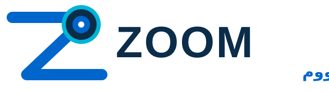
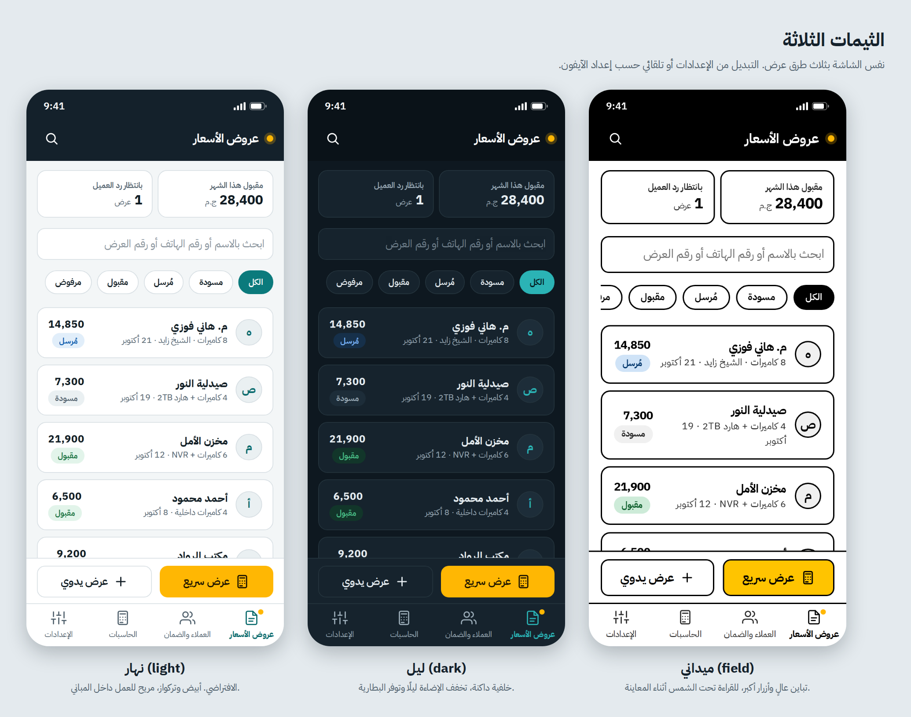
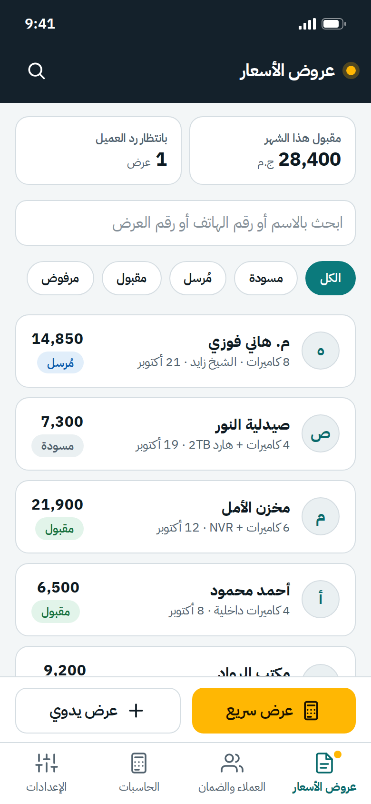
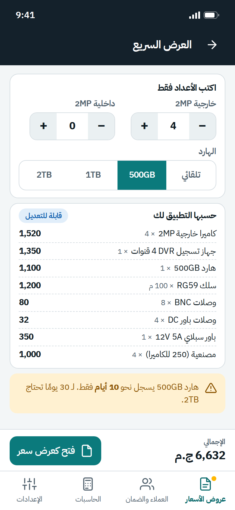
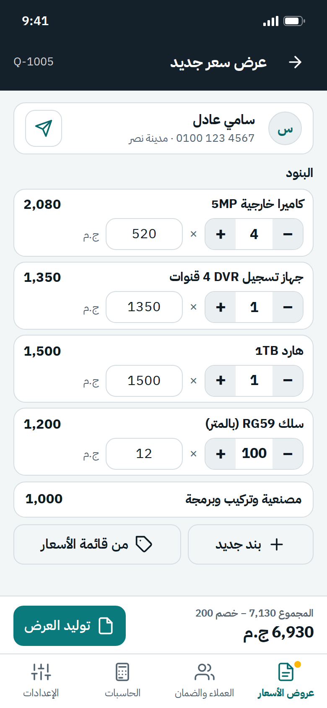
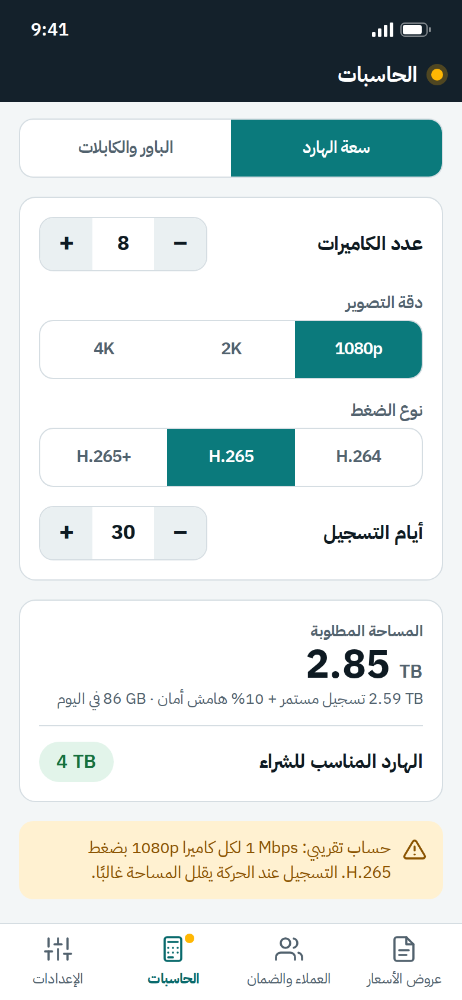
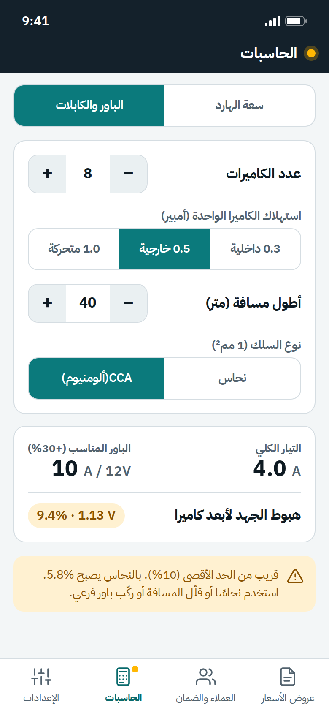
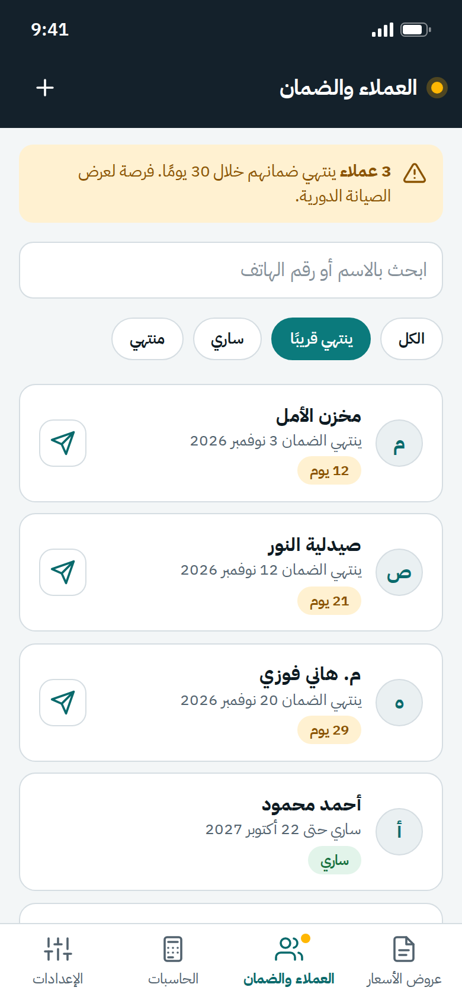
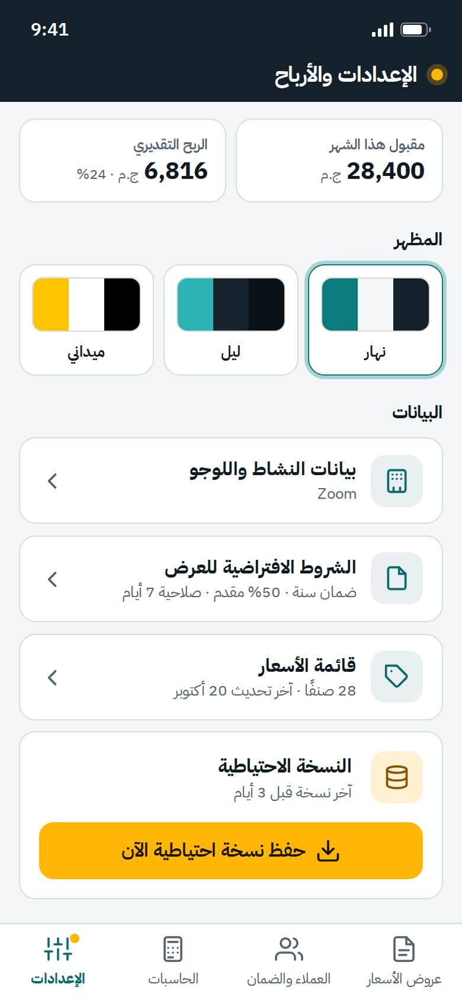

# دليل الهوية البصرية: ZOOM | زووم — CCTV Manager

## 1) الفكرة

العلامة المعتمدة هي **ZOOM | زووم**. شعار ZOOM المحلي يصوّر حرف Z مع عدسة كاميرا، ويستخدم الأزرق والكحلي والسماوي.
تظهر العلامة في الشريط العلوي وبيانات التطبيق وفي ترويسة عرض السعر. تبقى عناوين الأقسام والتسميات العربية نصًا فعليًا في HTML.

**الشعار المقترح:** معاينة. عرض سعر. ضمان.

## 2) الملفات

| الملف | الاستخدام |
|---|---|
| `../app-starter/assets/zoom-logo.svg` | شعار ZOOM | زووم المحلي للواجهة وعروض الأسعار |
| `../app-starter/icons/` | أيقونات التطبيق (192 و512 و180 و32) المتوافقة مع علامة ZOOM |
| `themes/themes-preview.png` | مقارنة الثيمات الثلاثة |
| `mockups/` | 8 صور للشاشات الأساسية |

**أيقونة الآيفون:** تستخدم أيقونة ZOOM المربعة بخلفية كاملة، ويقوم iOS بتدوير زواياها بنفسه.

## 3) الألوان

| الاسم | HEX | الدور |
|---|---|---|
| كحلي ZOOM | `#0B2D4A` | الشريط العلوي وخلفية الأيقونة وترويسة PDF |
| أزرق ZOOM | `#0066CC` | العلامة والأزرار الرئيسية في الثيم الفاتح |
| سماوي ZOOM | `#00B4D8` | العلامة وإبراز الإجراء النشط |
| أبيض | `#FFFFFF` | النص على الخلفيات الداكنة |
| ورق | `#F3F6F7` | خلفية الثيم الفاتح |

**قاعدة الاستخدام:** حافظ على ألوان شعار ZOOM وتباين النصوص. ألوان الحالات في ملفات الثيم الحالية تبقى كما هي.

## 4) الخط

**IBM Plex Sans Arabic** (ترخيص SIL OFL، محلي داخل `fonts/`) للعربي واللاتيني معًا. اختير لشكله الهندسي الذي يناسب أدوات الميدان والأرقام الواضحة.
الأوزان: 400 للنص، 600 للعناوين الصغيرة والأزرار، 700 للأرقام المهمة والعناوين.
الأرقام لاتينية (0-9) وبخاصية `tabular-nums` حتى تصطف المبالغ.

## 5) الثيمات

| الثيم | المفتاح | متى يُستخدم | ما يميزه |
|---|---|---|---|
| نهار | `light` | العمل داخل المباني | خلفية فاتحة، تركواز، وهو الافتراضي |
| ليل | `dark` | المساء وتوفير البطارية | خلفية داكنة، وتركواز فاتح |
| ميداني | `field` | الشمس أثناء المعاينة | أبيض وأسود بتباين 21:1، حدود 2px، أزرار 56px، خط أكبر 12% |

الملف: `app-starter/css/themes.css` (متغيرات الثيم الحالية تبدأ بـ `--ain-*` لأسباب توافق داخلية). والتبديل: `AinTheme.set('dark')` من `js/theme.js`. والوضع "تلقائي" يتبع إعداد الآيفون.

## 6) قواعد اللوجو

- **المساحة الفارغة:** اترك مساحة حول شعار ZOOM ولا تضغط أبعاده.
- **الخلفيات:** استخدم الشعار المحلي كما هو على خلفية فاتحة أو كحلية.
- **لا تفعل:** تغيير ألوان الشعار أو إضافة تفاصيل اتصال غير مقدمة من المستخدم.
- **في عرض السعر:** يظهر شعار ZOOM | زووم واسم النشاط وبيانات النشاط التي أدخلها المستخدم. عنوان المستند هو «عرض سعر».

## 7) الصور الأساسية

1. `01-quotes-list.png`: قائمة العروض والملخص
2. `02-new-quote.png`: نموذج عرض سعر جديد
3. `03-quote-pdf-a4.png`: شكل عرض السعر المطبوع
4. `04-hdd-calculator.png`: حاسبة سعة الهارد
5. `05-power-calculator.png`: حاسبة الباور وهبوط الجهد
6. `06-clients-warranty.png`: العملاء والضمان
7. `07-settings-profit.png`: الإعدادات والأرباح
8. `08-quick-quote.png`: العرض السريع من الأعداد

       

> الصور نماذج تصميم. بيانات العملاء والأسعار فيها تجريبية.

